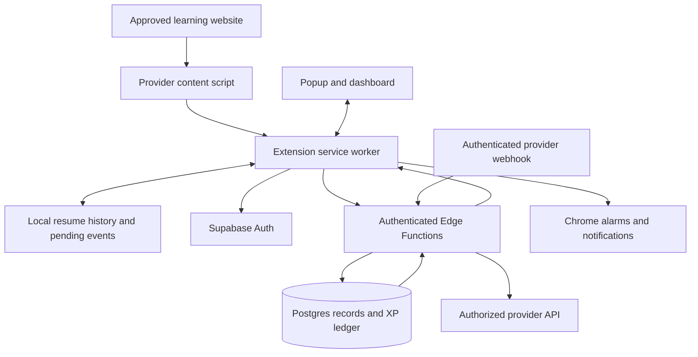

# Streak Maintaining App — Architecture

Version: 1.0  
Date: 2026-10-20  
Status: Implementation baseline; no services have been provisioned.  
Product contract: [PRD.md](PRD.md)

## 1. Architecture decision

Use a Chrome Manifest V3 extension built with WXT, React, and TypeScript. Use Supabase Auth, Postgres, and Edge Functions for cloud identity, authoritative activity records, and reward decisions. Keep resume history local in the first release.

There is no separately managed VM, message broker, or always-running application server in V1. Add infrastructure only when measured usage or an integration requires it.

## 2. System overview



Provider API and webhook paths exist only where an authorized integration supports them. Observations received through the browser path remain Browser tracked.

## 3. Stack and repository layout

| Concern | Choice |
| --- | --- |
| Extension build | WXT with Manifest V3 |
| Language/UI | TypeScript, React, CSS with shared design tokens |
| Validation | Shared Zod schemas for extension messages and API requests |
| Local state | React state for views; chrome.storage.local for persistence |
| Authentication | Supabase Auth email code flow; no password collection |
| Database | Supabase Postgres with migrations, constraints, and RLS |
| HTTP backend | Supabase Edge Functions |
| Rule calculations | Explicit domain functions plus transactional database operations |
| Validation tools | Vitest for domain rules; Playwright/Chromium for extension flows |
| Public pages | Static landing, compatibility, privacy, and support pages |

Suggested structure:

```text
entrypoints/
  popup/                 Quick daily overview
  dashboard/             Full extension page
  background.ts          Event coordination, sync, reminders
  provider.content.ts    First provider's content-script entry
src/
  components/            Shared accessible UI
  styles/                Tokens and shared styles
  domain/                Coverage, dates, goals, display calculations
  integrations/          Provider adapters and compatibility checks
  storage/               Versioned local schema and migrations
  api/                   Auth and backend client
  shared/                Message and request schemas
supabase/
  migrations/            Schema, constraints, grants, policies, functions
  functions/             Ingestion, provider verification, export, deletion
tests/                   Domain and extension acceptance coverage
public/                  Packaged icons and static extension assets
site/                    Public documentation and store support pages
```

Avoid a monorepo toolchain initially. Keep shared code in this repository and use ordinary package scripts.

## 4. Extension responsibilities

### Popup and dashboard

Read cached server state and local resume targets. Display pending and accepted results separately. Never award authoritative XP in UI code. A cached value can speed up display but cannot override the server.

### Provider content scripts

Run only on approved provider origins with granted permissions. Identify stable activity IDs, observe playback or completion signals, and emit bounded, schema-validated messages. Detect single-page navigation and incompatible page/player changes.

Content scripts cannot directly update rewards or privileged database records. They do not receive platform access tokens or server secrets.

### Background service worker

Validate message structure and sender origin, manage local checkpoints and pending uploads, call authenticated APIs, schedule reminders, and coordinate duplicate tabs. Assume the worker can stop at any time; persist durable state before acknowledging an operation that depends on it.

Use a stored owner/lease per local activity to reduce duplicate observations across tabs. Server idempotency remains necessary even when the lease works.

### Permissions

Start with storage and the permissions required for explicitly enabled reminders and authentication. Declare optional host access for supported providers and request it during connection. Add scripting, tabs, identity, or other permissions only when an implemented feature requires them. Do not request general browsing-history access or all-sites access by default.

Use chrome.storage.local.setAccessLevel to restrict activity storage to trusted extension contexts. Let content scripts communicate through validated messages. This reduces exposure to page-facing code; it does not prevent the device owner from editing data.

## 5. Local data

Persist a versioned schema containing:

- Preferences and cached account/streak summaries.
- Resume targets: streak ID, provider ID, activity ID, sanitized canonical URL, title, position, and last saved time.
- Unfinished coverage checkpoints and local activity leases.
- Pending browser events with stable event UUIDs and retry metadata.
- Authentication session in a dedicated storage namespace accessible only to trusted extension contexts.

Checkpoint active playback approximately every five seconds and on pause/navigation when possible. Bound and merge coverage intervals so local state cannot grow without limit. Limit pending events to seven days or 1,000 events, whichever is reached first; report discarded pending progress instead of silently claiming it synced.

Extension storage is not an encrypted vault or a source of trusted evidence. Device compromise, profile deletion, and deliberate user edits are outside its protection. Never embed a supposedly secret anti-cheat signing key in the extension.

Each account's local data is namespaced by account ID. Sign-out clears session material, account resume history, and local account caches after handling pending-event loss explicitly. Account deletion also clears these records on the requesting device.

## 6. Provider adapter contract

Each adapter declares:

- Supported HTTPS origins and page patterns.
- Stable provider activity IDs and canonical resume URL construction.
- Activity rule and rule version.
- Evidence level and available server verification method.
- Observable player/completion events and checkpoint format.
- Supported playback speeds, visibility rule, and unsupported conditions.
- Compatibility fixtures and manual validation steps.

The first provider is GeeksforGeeks free articles, selected on 2026-10-22. See [INTEGRATION_GEEKSFORGEEKS.md](INTEGRATION_GEEKSFORGEEKS.md) for inspected page signals, proposed reading rules, and limitations. No official article-completion API was identified; the planned evidence level is Browser tracked.

Executable adapters are bundled in the extension. Remote configuration may disable a broken adapter or change bounded non-executable settings. It must not download scripts or introduce undisclosed functionality.

## 7. Video coverage algorithm

1. Establish activity identity, eligible duration, current media time, monotonic observation time, playback speed, and visibility.
2. On the next observation, check playback continuity against elapsed time and speed with a small documented tolerance.
3. If playback was eligible and continuous, add its observed media interval.
4. If seeking, buffering, navigation, a long observation gap, or unsupported speed occurred, reset the baseline without filling the gap.
5. Merge accepted overlapping intervals and calculate union length divided by eligible duration.
6. At the threshold, submit one completion candidate with rule version and bounded evidence summary.

Merge unfinished intervals for the same account/activity across sessions without double-counting. For V1, cross-device partial video coverage is not combined; completed activities are reconciled through the server.

The server can reject malformed intervals, impossible values, duplicate activity credit, and excessive submissions. A forged browser client can still fabricate plausible intervals. Do not describe these checks as independent playback verification.

## 8. Backend data model

| Table | Essential fields and constraints |
| --- | --- |
| profiles | user_id, timezone, preferences, schema version |
| streaks | id, user_id, provider_id, name, status, created_at |
| streak_rule_versions | id, streak_id, completion rule, timezone, effective boundary |
| streak_runs | id, streak_id, start/end boundary; new run after reactivation |
| provider_connections | id, user_id, provider account identity, status; secrets stored separately |
| activity_events | id, user_id, event_uuid, provider/activity IDs, received_at, status, evidence level, bounded evidence |
| provider_activity_credits | user_id, provider_id, activity_id with unique credit constraint |
| daily_completions | streak_id, run_id, local_date, event_id, rule_version_id, evidence level; unique streak/date |
| points_ledger | user_id, streak_id, award_key, amount, reason, created_at; unique award_key |
| milestone_awards | streak_id, milestone; unique streak/milestone |

Use server-generated timestamps for receipt and independently verified provider timestamps where allowed. No arbitrary client-supplied backdating.

Store provider secrets in server-only encrypted storage with narrowly scoped access; document key management before implementing a token-based provider integration. Never include them in exports, client-readable rows, or logs.

## 9. Authentication and authorization

Use email one-time codes with Supabase Auth. The extension holds its own session so it can sync after restarting. Codes are never logged. Configure delivery, abuse controls, expiry, and redirects for the production flow before release.

Every user-facing backend endpoint validates the access token and derives user identity from it. Never trust a user_id supplied in a request body. Rate-limit authenticated ingestion and bound request sizes.

Enable RLS on exposed user tables. Users may read their own records and perform explicitly permitted goal/settings changes. Deny client writes to activity acceptance, daily completions, points, milestone awards, and provider secrets. Privileged database functions must have restricted execute grants and safe search paths. Server service credentials remain exclusively in server secrets.

If an Edge Function uses privileged database access, it must explicitly enforce ownership because that access can bypass RLS. CORS and checking an extension origin are not substitutes for authentication.

## 10. API contracts

| Operation | Contract |
| --- | --- |
| Create/update/archive streak | Authenticated request; validate provider/rule and record effective version. |
| GET streak summary | Return server-calculated counts, XP, evidence labels, and server time. |
| POST activity event | event UUID, streak ID, rule version, provider/activity ID, bounded browser evidence; return accepted, pending, duplicate, or rejected. |
| Verify provider activity | Server fetches evidence with authorized credentials and checks provider account ownership. |
| Provider webhook | Authenticate signature or equivalent provider mechanism; reject replays; derive account mapping server-side. |
| Export account | Authenticated export of non-secret records. |
| Delete account | Recent authentication; revoke connections where supported, remove active account data and auth identity. |

Use machine-readable error codes plus human-readable explanations. Do not accept a client-provided XP amount, verification level, or authoritative streak count.

## 11. Transactional completion and rewards

1. Authenticate, validate payload, check rule version and streak ownership/status, and rate-limit.
2. Insert or find the event under unique (user_id, event_uuid).
3. Verify provider evidence independently when supported; otherwise retain Browser tracked classification.
4. Determine the qualifying date using server receipt time for browser events or validated provider time within the seven-day reconciliation window.
5. In one database transaction, acquire a suitable per-streak lock, claim provider activity credit, create the unique daily completion, and insert unique daily and milestone XP awards.
6. Return the authoritative result and summary.

Serialize competing reward updates and use database uniqueness constraints so retries and simultaneous tabs cannot award twice. Do not award historical events under a rule that was not effective at their qualifying time. Corrections, if needed, append auditable adjustments rather than silently editing the points ledger.

Derive current and best streaks from qualifying dates and run boundaries. Start with indexed date queries; add cached aggregates only if performance requires them. A midnight reset cron is unnecessary.

## 12. Offline behavior and reminders

Persist pending browser submissions and retry with backoff when connectivity returns or the extension next wakes. Reuse the event UUID on every retry. The server receipt-date rule deliberately avoids trusting an editable device clock.

Use Chrome alarms to evaluate reminder eligibility and Chrome notifications to deliver it. Recreate/check alarms on startup and after settings changes. Persist reminder deduplication by streak/date. On delayed wake, suppress expired reminders and reminders that now fall in quiet hours. Chrome being closed or the device asleep prevents guaranteed delivery.

Contextual nudges trigger only when the user leaves or switches away from an actively tracked supported learning page and today's goal is unfinished. Keep the active streak ID and nudge state locally; do not record or inspect the destination URL. Apply a grace period, per-session deduplication, and an opt-out. Show current daily progress, optional motivation and a user-defined article milestone; do not infer progress toward an open-ended aspiration. Step 14 below documents the implemented permission and delivery rules.

Server-based email reminders are outside V1. If introduced, they require explicit opt-in, an email provider, a scheduler, and separate delivery/deduplication rules.

## 13. Privacy, retention, and deletion

Local resume URLs and positions are not uploaded in V1. Server records contain the minimum provider/activity identifiers needed for acceptance and deduplication. Reject arbitrary page HTML, screenshots, credentials, and unrelated URLs at ingestion.

Retain accepted completion records and points while the account exists. Proposed raw browser-evidence retention is 30 days, after which keep the result, rule version, identifiers, and minimal audit metadata. Set operational log retention to 14 days and exclude access tokens, email codes, raw URLs, and evidence payloads. Implement scheduled cleanup before public launch.

Deletion is a retryable server workflow that disables new ingestion, removes connections/secrets and user records, then removes the auth identity. Define and disclose the managed backup expiry window before launch; do not promise immediate removal from provider backups. Uninstall is not a cloud deletion signal.

## 14. Deployment and operations

- Maintain separate development and production Supabase projects and credentials.
- Apply versioned migrations through a repeatable deployment process.
- Deploy Edge Functions and configure secrets outside Git.
- Bundle and ZIP the extension using WXT for Chrome Web Store submission.
- Host public support/privacy pages on a static host selected before launch.
- Bundle all executable extension code and restrict provider permissions.
- Track API error rate, ingestion latency, duplicate/rejection counts, and adapter failures without raw browsing data.
- Configure service budget alerts, backup policy, recovery instructions, and a way to disable a failing integration.
- Store reviews can delay extension fixes; communicate provider outages and use a safe server-side adapter-disable flag.

No production account, paid plan, domain, or publication is authorized merely by these documents.

## 15. Validation strategy

Cover meaningful failure modes:

- Unique timeline coverage, seeking, playback-rate changes, long gaps, and interval merging.
- Local-date calculations around midnight, DST, rule changes, and missed days.
- Concurrent submissions, activity deduplication, one-time milestones, and atomic XP awards.
- Cross-user access denial, forged user IDs, direct reward writes, and invalid provider signatures.
- Worker shutdown, restart persistence, offline queues, migrations, and duplicate tabs.
- First-use permission denial, disconnected sites, Continue behavior, export, and deletion.

Use integration fixtures and a real supported-provider smoke check before releases. Track fixtures by provider/rule version so website changes can be diagnosed. Do not mistake passing fixtures for current website compatibility.

## 16. Architectural boundaries and future changes

- Public repository visibility does not grant access to cloud records or credentials.
- A local-only variant can be useful for personal tracking but cannot promise authoritative tamper-resistant rewards.
- Platform verification depends on provider access and is never inferred from server storage.
- Add cross-device resume only after specifying user consent and URL retention.
- Add competitive rewards only after defining stronger abuse controls and eligible evidence levels.
- Add additional providers through the adapter contract, compatibility checks, and privacy/permission review.

## 17. Primary implementation references

- [WXT introduction](https://wxt.dev/guide/introduction.html)
- [Chrome extension tutorial and local installation](https://developer.chrome.com/docs/extensions/get-started/tutorial/hello-world)
- [Chrome content scripts](https://developer.chrome.com/docs/extensions/develop/concepts/content-scripts)
- [Service worker lifecycle](https://developer.chrome.com/docs/extensions/develop/concepts/service-workers/lifecycle)
- [Extension storage](https://developer.chrome.com/docs/extensions/reference/api/storage)
- [Chrome alarms](https://developer.chrome.com/docs/extensions/reference/api/alarms)
- [Extension security](https://developer.chrome.com/docs/extensions/develop/security-privacy/stay-secure)
- [Manifest V3 code restrictions](https://developer.chrome.com/docs/webstore/program-policies/mv3-requirements)
- [Chrome Web Store publishing](https://developer.chrome.com/docs/webstore/publish)
- [Supabase Auth](https://supabase.com/docs/guides/auth)
- [Supabase Row Level Security](https://supabase.com/docs/guides/database/postgres/row-level-security)

Verify provider-specific APIs and current deployment configuration against their official documentation when implementing them.

## Local goal storage (Step 04)

The dashboard owns goal creation, editing, archiving, restoration, and confirmed deletion. The popup shows active saved goals. Sample progress remains available only through Explore design demo and is never copied into saved goals.

`chrome.storage.local.goalStore` contains `{ version: 1, goals: [...] }`. Each goal has an ID, name, daily target, unit, and archived flag. The background worker serializes mutations and validates input; UI pages subscribe to storage changes. Missing data initializes schema 1 (Step 03 stored nothing). Existing schema 1 is preserved; unknown versions or damaged records block writes instead of resetting data. Future schema changes require explicit migrations in src/goals.ts.

The only production permission is storage. Local data survives normal tab/browser closure and extension updates with the same extension identity. It is not a backup: uninstalling the extension, clearing extension/profile data, or losing the profile can remove it. Local goal data is editable by the device owner and is never authoritative completion or XP evidence. No integration is connected at this checkpoint.

## Saved lesson links (Step 05)

Schema 2 adds a nullable `location` containing a sanitized HTTPS URL, its explicitly approved origin, and an optional user-entered title. Schema 1 goals migrate intact with `location: null`. The same validator runs before saving and before opening a stored destination. Credentials, non-HTTPS schemes, custom ports, obvious local/IP destinations, and mismatched approved origins are rejected. Query strings and fragments are removed; this manual-bookmark prototype supports path-based lesson URLs only. Users must avoid private information embedded in paths or titles.

Continue queries open tabs only on a user request, focuses an exact matching URL (including its window), or creates a new tab. The `tabs` permission exposes tab URLs for this comparison; no tab history is saved or sent to a server. Browser API failures appear in the UI. The destination website handles missing pages and sign-in; the extension cannot determine whether the lesson is available without an integration. Users can edit or clear the saved URL.

This is a manual bookmark, not a provider connection or verified activity record. Provider/activity IDs and playback checkpoints must come from the approved adapter in Step 08, rather than being invented from an arbitrary link. Opening a link never grants streaks or XP. Resume links remain local and survive normal browser restarts.

## Local streak prototype (Step 06)

`src/streaks.ts` is a standalone, JSON-serializable prototype ledger. It calculates local dates using Intl and finds the next actual midnight by timestamp search, so it does not assume every day has 24 hours. Daily qualification records retain the date, rule version, run, activity identifier, and awarded prototype XP. Daily XP is 25; lifetime-per-goal milestones are 3/7/14/30/100 days for 20/50/100/250/1000 bonus XP. An account-level activity list prevents duplicate rewards across goals and remains after a goal is deleted, along with lifetime XP.

Today can remain unfinished without breaking yesterday's run. A missing prior day resets current length, retaining best length and XP. Archive blocks completions; restore starts a new run. Rule/timezone edits are versioned and scheduled at the next boundary of the current timezone. New edits replace an unapplied pending change. Completion dates never move backward, and a timezone change cannot award another completion within the previous completion's day window. An eastward timezone change that skips a calendar date breaks the run; westward moves may delay eligibility until the date advances. Invalid zones and backdated event timestamps are rejected.

The dashboard's Streak scenario control uses fixed fictional January 2026 events and this calculation engine. Its ledger is rebuilt in memory, never persisted into saved goals or sent through the background worker. Saved-goal edits still edit plans because those goals have no tracking history yet. There is no manual completion message endpoint. The engine is not an anti-tamper or server-verification boundary: adapters and authoritative ingestion must enforce evidence and server time in later checkpoints. The serialized-ledger roundtrip is tested; production persistence/synchronization remains future work.

## Live local reading (Step 08)

The Connections screen requests optional GeeksforGeeks origin access and registers bundled gfg.js via scripting only after the user connects a saved goal. src/reading.ts holds bounded reading rules, src/reading-worker.ts validates messages and persists local records, and entrypoints/gfg.ts measures eligible text-range visibility and interaction timing. Messages from extension pages cannot submit article evidence. Browser data remains editable by the device owner; authoritative reward ingestion is still Step 12.

The selected goal, article checkpoints and prototype ledger live under versioned gfgReading, separately from goalStore. Partial coverage and canonical resume positions stay local. Basic writes are serialized with goal mutations in the background worker. Crash-safe combined transactions, worker restart leases and event queue recovery are explicitly Step 09 work. No server requests or provider credentials are used.


### Step 09 implementation: local recovery

Reading checkpoints and a bounded pending local-award queue share the gfgReading value. Each qualifying day creates one UUID plus its deterministic daily activity key; the checkpoint and pending event are persisted before applying the local award. Queue removal and ledger updates share a subsequent single-value write. Recovery replays the original timestamp and checks the ledger activity key before awarding. Goal lifecycle mutations wait for pending awards to finish, avoiding reward/rule reordering. Missing pending fields in existing version-1 records mean an empty queue.

Recovery runs through the worker's serial queue on wake, each reading request, and a one-minute alarm. Failures retain the event, error and exponential retry deadline (maximum five minutes); reading pauses to avoid building later events ahead of a failed award. The 1,000-event hard ceiling preserves queued data. These local events do not expire after seven days: the seven-day policy above concerns the future cloud ingestion queue. No cloud transport or trusted import exists yet.

Only active observations replace another tab's timing baseline; hidden duplicate messages cannot clear the active baseline. Baselines deliberately reset after worker shutdown, preventing credit for unobserved downtime. Continue intents use session storage with URL/fingerprint validation and a one-minute expiry, survive worker suspension, and disappear after browser restart. Existing-tab resume messages also require matching content fingerprints. Goal definitions and related reading rule changes are passed in one storage.set call, reducing split writes; Chrome storage is not a general ACID transaction database.

Content-script communication failures back off from two to thirty seconds, display a paused/retrying state, and require fresh interaction before credit resumes. Previously acknowledged checkpoints remain durable. Sudden termination can lose the final unacknowledged observation. No new dependency was added; alarms is the additional permission.


### Step 10 implementation: database foundation (2026-10-25)

The initial Supabase SQL migration implements the ten planned tables. Every exposed table has RLS plus explicit grants: authenticated users can select their own rows, anonymous users have no access, and client writes are denied. Profile and goal mutations will go through validated server operations to preserve rule/run history. No mutation or reward RPC is exposed before the corresponding validator is implemented. The service role can write application records and must remain server-only.

Composite ownership foreign keys, unique daily/event/activity/award/milestone constraints, one open run per streak, bounded JSON, target/unit checks and a restricted IANA-timezone helper are implemented. Browser tracked is the only evidence label currently accepted. Provider credentials and local resume URLs have no columns. The service layer must still allowlist evidence fields, apply server receipt dates, enforce lifecycle boundaries and atomically calculate awards; schema constraints do not replace Step 12 validation. Goal removal uses soft deletion to retain lifetime rewards; Auth account deletion cascades through owned records.

The development-only PGlite runner executes the real migration with minimal Supabase role/Auth shims and two users. It checks SQL authorization and constraints, not hosted JWT verification, PostgREST, or multi-connection concurrency. The user requested local preparation only; no Supabase project, auth flow or cloud transport was configured. Setup and limitations are in supabase/README.md.


### Step 11 implementation: accounts (2026-10-25)

The background worker owns the Supabase SDK and serializes account operations. Build-time public configuration enables one project origin in host_permissions; an unconfigured build retains local-only operation. Auth uses email OTP, persistent chrome.storage.local with TRUSTED_CONTEXTS access, disabled URL-session detection and SDK refresh on session access. Tokens never enter account message responses; website/content-script callers cannot invoke these actions. getUser verifies the identity before account operations. Explicit local sign-out clears persisted tokens and account caches even when remote revocation cannot be confirmed.

Account-goal caches are scoped to project and verified user ID and removed on sign-out/switch. Device prototype goals/reading state retain their existing shared-browser scope and are labeled accordingly; signing in never makes them authoritative account progress. Explicit copy sends only UUID/name/target/unit. The authenticated copy_goal_definitions RPC derives auth.uid(), validates at most 100 definitions, locks the profile, and inserts goals, initial rules and runs transactionally with per-user local-ID deduplication. Its fixed search path and explicit EXECUTE grant restrict the SECURITY DEFINER entry point. Profile timezone is initialized on first copy, not rewritten on every login. No URLs, credentials or XP are copied.

Local tests use mocked Auth responses and the real SQL migration in PGlite. Hosted email/JWT/Data API and concurrent RPC behavior require a real development project. Source implementation is complete locally; no hosted deployment or live sign-in is claimed.


### Step 12 implementation: authenticated ingestion and atomic rewards

The third migration implements submit_reading_event, get_streak_summary and
set_reading_connection as authenticated database RPCs. A separate Edge Function is
unnecessary for the current database-only validator: the Data API JWT plus auth.uid()
provide caller identity, and the privileged functions explicitly check ownership.
Direct client writes remain revoked. Private helpers use fixed search paths and
restricted grants. No client-supplied date, user, XP or evidence label is accepted.

The reading contract allowlists schema version, fingerprint, bounded chunk weights,
dwell and active seconds. Qualified distinct articles count toward receipt-day
lesson targets or minute targets. Minute amounts include qualified articles only;
partial unqualified reading is not submitted by this initial server API. Step 13
must keep local preview counts and accepted cloud counts clear. All results remain
Browser tracked, without provider verification.

A profile lock serializes per-account ingestion/credit/rate state; a streak lock
protects completion updates. Database receipt time after locks determines rule and
date. Accepted event UUIDs and payloads are stored for replay/conflict handling.
The event, activity credit, daily completion, 25 daily XP and one-time milestone
bonuses commit together. Summary derives current/best from dates and runs and sums
ledger XP. Future rules and overlapping/backward reward days are rejected.

Private rate state limits fresh attempts to 60/minute/account; exact accepted replays
are idempotent. Receipt-day accepted events are capped at 2,000 and claimed seconds
at 86,400 across the preceding 24 hours. Business rejections return codes without
retaining evidence. A SQL evidence-size bound protects storage after parsing; HTTP
body and global/IP abuse limits still belong at the deployment boundary.

Local SQL tests verify authorization, evidence checks, every reward milestone,
replay/deduplication, missed days, scheduled-rule rejection and transactional rollback.
PGlite cannot establish multi-connection concurrency behavior; row-lock/uniqueness
checks must also run on a real development database before release. No deployment
or extension-to-server submission is included in this checkpoint.

## Step 13 implementation note (2026-10-26)

Cloud synchronization is explicitly enabled after sign-in, goal-definition copy and local provider connection. New article checkpoints receive a generation ID, UUID, cloud goal ID and current rule ID. Existing articles are never retroactively bound. Qualification persists its timestamp and evidence in the reading checkpoint before synchronization discovers it. The cloud outbox captures an immutable payload keyed by that UUID; rediscovery after a worker stop cannot duplicate it.

One project-scoped cloud store contains the verified owner, generation, goal summaries and pending/terminal submission records. Cloud/auth operations share a promise queue independent of the reading checkpoint queue, so background network waits do not block sampling. Sign-out/switch clears the cloud store under that lock; UI explains pending loss beforehand. New generations prevent old article bindings from crossing accounts or being imported after sign-out. Content scripts cannot call cloud/account operations or access trusted local storage.

Synchronization runs on qualification, worker wake, one-minute alarm and explicit refresh. Each pass processes at most ten due events; transient failures retain exact IDs/payloads, exponential retry deadlines and a one-minute pass cooldown. Rate limits wait at least one minute. Seven-day expiry and the 1,000-record ceiling are visible; the current 200-article device ceiling bounds normal usage further. Terminal records drop payloads and retain explanations/IDs to prevent repeated submission. Expiry warns that an earlier unconfirmed attempt may have reached the server.

Accepted/replayed responses are never added to local XP. Fresh summary RPCs replace cached server totals, including changes from other devices; their date/fetch time are displayed explicitly. Rejected/stale-rule events are terminal and never silently rewritten under new IDs. Only new articles use refreshed rule mappings. Local goal edits do not mutate the copied cloud definition. Cloud minute totals include only accepted qualified articles and browser credit uses server receipt date. Offline local prototype results remain separate.

No new dependency or database migration is required. Tests exercise extension-to-mocked-service behavior plus the existing real local SQL validator; a real configured Supabase project, HTTP/JWT enforcement and simultaneous database/device checks are still required before release.

## Step 14 implementation note (2026-10-26)

The notifications permission is optional. Settings requests it from a user gesture; the worker checks the grant and notification permission level before saving enabled preferences or delivering. Chrome omits this API before the grant, so handlers register only when the namespace exists and again after permission changes. A one-minute reminder alarm is recreated on worker startup when an active goal has enabled reminders. No new dependency or cloud service is used.

Local reminderSettings stores versioned per-goal preferences, shared quiet hours, the latest reserved date per goal, one current notification and one explicit snooze. Eligibility uses the current rule's timezone, local completion/progress and same-day cached cloud completion. Scheduled delivery has a 60-minute window; snoozes have a 15-minute late window and cannot cross learning days. Daily/contextual delivery shares a single automatic-per-day budget. The marker and notification ID are persisted before calling Chrome: interruption or API failure can lose a reminder but cannot cause an automatic repeat. Failed delivery is reported in Settings. Continue revalidates the goal and reuses the existing tab/resume helper; snooze/dismiss IDs must match the current notification.

Validated foreground samples maintain a minimal reminderSession in session storage only after reminder opt-in. It contains source tab ID, goal ID, activity timestamps, observed seconds, away timestamp and nudge marker; no destination URL is read or saved. Tab activation, source-tab loading/closure and browser-window activation mark leaving. Returning cancels the grace period; resumed reading clears the notification/snooze. A nudge needs 30 seconds of active samples and 60 seconds away, expires after 15 minutes away and is limited to one per session and the shared daily cap. Sessions reset after 30 minutes without active reading and are not restored across browser restart.

Reminder mutations and Chrome callbacks use the existing worker serialization queue. Notification-related failures do not roll back saved reading or goal operations. Archived/deleted/disconnected/completed goals and revoked permission invalidate delivery; deletion prunes preferences. General history, unrelated page contents and notification content are never sent to a server. The two native buttons are Continue and Snooze; close is Dismiss. Native OS display and permission prompts remain manual validation; automated checks intercept delivery in an isolated package.

References: [Chrome notifications](https://developer.chrome.com/docs/extensions/reference/api/notifications) and [Chrome alarms](https://developer.chrome.com/docs/extensions/reference/api/alarms).

## Step 15: history and rewards (2026-10-26)

ProgressPage reuses the existing goal/reading hooks and pure streak engine. Device history uses ledger completion dates, milestone awards and per-goal XP; an untracked goal displays zero recorded progress. The month calendar uses UTC only for calendar arithmetic, never to reinterpret a recorded local_date. Completed cells have text equivalents, weekday headings and a today marker. Native month/select controls support keyboard use; responsive cards and global reduced-motion styles apply.

The extension-page-only cloud/history message runs in the existing cloud/auth lock. It verifies the signed-in user, reads their active and archived streak definitions, requests get_streak_summary, and reads a bounded month of daily_completions plus milestone_awards. Existing owner RLS and explicit user/goal filters protect these reads. No queue status or client XP is treated as server history. No migration, new dependency or additional permission is needed.

Cloud history is held in the mounted page only, cleared on source/goal/month changes and authentication-storage changes, and not persisted offline. Cancelled requests cannot update an unmounted or superseded view. Failed reads display an error and retry control rather than zero-filled results. The fetched time makes snapshot freshness explicit. Individual read requests are not an atomic database snapshot; a completion arriving during a fetch may require Refresh to reconcile the calendar and totals.

## Step 16: privacy implementation (2026-10-26)

The extension-only privacy message runs under both the reading/goal queue and the cloud/auth lock, so cleanup cannot race a local reward write or outbox submission. Unlike normal goal operations, cleanup is routed before goal schema parsing, allowing the user to erase malformed activity data. The local export explicitly projects known fields; it never reads credential storage, account caches or cloud outbox payloads. The dashboard creates an expiring Blob URL and a native JSON download, without adding a downloads permission.

Clear device activity disconnects the reader first, resets in-memory sample baselines, unregisters injection, requests origin revocation, clears resume/session state and notification/alarm state, resets the local ledger, drops pending submissions and strips bookmarks while retaining goal definitions and sign-in. Account deletion uses the same path with goal deletion, followed by credential/cache removal. Website callers cannot invoke any privacy operation. Typed confirmation is checked in both UI and worker. Network failures preserve local data until cloud deletion is confirmed.

Migration 4 adds export_my_account and delete_my_account. Fixed empty search paths, explicit execute grants and auth.uid() ownership prevent choosing another user's ID. Export selects named application fields in a database snapshot; identity/email comes from a remotely verified account. Deletion locks the profile in ingestion's lock order, deletes only the caller's auth.users row and relies on existing cascading ownership constraints. No service key is exposed to the client. The deletion RPC is idempotent even with an already-deleted identity and an unexpired JWT, so a lost response can be retried without getUser. A failed database delete rolls back dependent deletions. After identity deletion, FK checks prevent new profiles/copies and ingestion finds no profile. A signed-in JWT is required; re-entering an email OTP is not required for this operation.

Authoritative 400/401/403 session invalidation and 401/403 identity responses clear account credentials/cache/outbox on the next check; transient network failures retain them. Cloud synchronization checks that its queue generation still exists before persisting an error, so invalidation cannot resurrect erased account data. Independent local activity on other devices remains device-owned.

private.cleanup_expired_evidence is available only to the migration owner/service role. It clears raw event evidence older than 30 days and obsolete private ingestion counters older than one day. SHA-256 of canonical JSONB evidence preserves exact replay/conflict protection after cleanup; completion dates, result snapshots, activity deduplication and XP remain. Migration 4 replaces the ingestion function to compare digests while preserving its validations. The prepared daily cron setup also removes job execution metadata older than 14 days. It is not installed in an external service yet. No request/evidence logging or analytics service is implemented; hosted provider logging and backup expiry are unconfigured release decisions, not promises of immediate erasure from backups.

Supabase documents direct deletion of auth.users and the fact that issued JWTs remain valid until expiry: https://supabase.com/docs/guides/auth/managing-user-data. Retention schedules follow https://supabase.com/docs/guides/cron/quickstart. Actual deployment retention must be checked against https://supabase.com/docs/guides/platform/backups before public release.

## Step 17 implementation (2026-10-26)

Migration 5 introduces private.adapter_status, restricted to administrators/service_role, and checks it after accepted-event replay and account rate limiting but before new acceptance. A missing/disabled provider fails closed with PROVIDER_PAUSED. Client synchronization persists the original event as pending with a five-minute retry; it does not award XP. Local prototype reading is independent of this cloud-only switch. OPERATIONS.md documents pause/resume, in-flight transaction limits and seven-day queue expiry.

The build rejects secret-like WXT variables, invalid cloud origins/keys, and missing public cloud settings when STREAK_RELEASE=1. The flag is a packaging guard only. npm run check serializes the existing tests because fixture builds share .output; it captures HEAD/dirty state and results, then creates a ZIP and checks its extracted contents/install/profile persistence. The GitHub workflow has read-only repository access, uses no live service secrets and uploads only aggregate check results and the development package/checksum for seven days. It does not upload fixture profiles or user data. Hosted production verification remains required.

## Step 18: beta preparation (2026-10-26)

npm run beta runs the sequential gate and then assembles an allowlisted folder from the checked extension ZIP plus beta instructions, limitations, feedback template, checksum and build metadata. The builder verifies passed stages, revision and ZIP checksum; labels dirty working trees explicitly; and never packages .env, test profiles or user exports. CI can upload that same bundle after successful checks. Participant testing/public launch are not inferred from internal results.

The trusted privacy/export-diagnostics action reads only goal/reading/reminder/cloud state and emits named numeric counts, Boolean flags and the extension version. It never reads authentication storage, sends network requests or exports names, URLs, user identifiers, motivation text, evidence or raw errors. The existing native Blob download is reused. Sharing is optional, initiated and reviewed by the user; it is not an analytics endpoint. Feedback measurements remain manual aggregate counts with explicit denominators and no stable participant identifiers in the repository.

## Step 19: store review preparation (2026-10-26)

npm run store:prepare runs the local gate, reuses the beta builder and creates an allowlisted draft review folder. It copies the exact checked ZIP/hash, records source/dirty state and captures Today/History/Rewards at 1280×800 from an isolated extension/profile with synthetic ledger records. A sample caption and actual development badges remain visible. Fixture permission pregrant affects only the capture copy, never the distributable ZIP. No personal profile, live account or third-party article content is captured. The 128px package/store icon uses a code-native SVG optical variant with transparent padding.

The review folder includes listing, privacy/data-permission mapping, reviewer path, release notes and explicit submission/approval/publication status. Draft policy/operator details must be finalized and publicly hosted by the owner before submission. Screenshots must be recaptured from the final release UI/package. The script and CI do not contact a developer account, upload a store item, publish a website or submit anything to review. store/STATUS.json and RELEASE_CHECKLIST.md track the remaining external gates.
