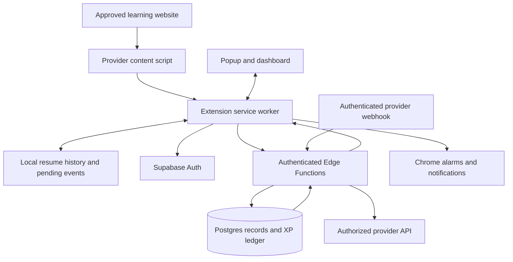

# Streak Maintaining App — Architecture

Version: 1.0  
Date: 2026-10-20  
Status: Implementation baseline; no services have been provisioned.  
Product contract: [PRD.md](PRD.md)

## 1. Architecture decision

Use a Chrome Manifest V3 extension built with WXT, React, and TypeScript. Use Supabase Auth, Postgres, and Edge Functions for cloud identity, authoritative activity records, and reward decisions. Keep resume history local in the first release.

There is no separately managed VM, message broker, or always-running application server in V1. Add infrastructure only when measured usage or an integration requires it.

## 2. System overview



Provider API and webhook paths exist only where an authorized integration supports them. Observations received through the browser path remain Browser tracked.

## 3. Stack and repository layout

| Concern | Choice |
| --- | --- |
| Extension build | WXT with Manifest V3 |
| Language/UI | TypeScript, React, CSS with shared design tokens |
| Validation | Shared Zod schemas for extension messages and API requests |
| Local state | React state for views; chrome.storage.local for persistence |
| Authentication | Supabase Auth email code flow; no password collection |
| Database | Supabase Postgres with migrations, constraints, and RLS |
| HTTP backend | Supabase Edge Functions |
| Rule calculations | Explicit domain functions plus transactional database operations |
| Validation tools | Vitest for domain rules; Playwright/Chromium for extension flows |
| Public pages | Static landing, compatibility, privacy, and support pages |

Suggested structure:

```text
entrypoints/
  popup/                 Quick daily overview
  dashboard/             Full extension page
  background.ts          Event coordination, sync, reminders
  provider.content.ts    First provider's content-script entry
src/
  components/            Shared accessible UI
  styles/                Tokens and shared styles
  domain/                Coverage, dates, goals, display calculations
  integrations/          Provider adapters and compatibility checks
  storage/               Versioned local schema and migrations
  api/                   Auth and backend client
  shared/                Message and request schemas
supabase/
  migrations/            Schema, constraints, grants, policies, functions
  functions/             Ingestion, provider verification, export, deletion
tests/                   Domain and extension acceptance coverage
public/                  Packaged icons and static extension assets
site/                    Public documentation and store support pages
```

Avoid a monorepo toolchain initially. Keep shared code in this repository and use ordinary package scripts.

## 4. Extension responsibilities

### Popup and dashboard

Read cached server state and local resume targets. Display pending and accepted results separately. Never award authoritative XP in UI code. A cached value can speed up display but cannot override the server.

### Provider content scripts

Run only on approved provider origins with granted permissions. Identify stable activity IDs, observe playback or completion signals, and emit bounded, schema-validated messages. Detect single-page navigation and incompatible page/player changes.

Content scripts cannot directly update rewards or privileged database records. They do not receive platform access tokens or server secrets.

### Background service worker

Validate message structure and sender origin, manage local checkpoints and pending uploads, call authenticated APIs, schedule reminders, and coordinate duplicate tabs. Assume the worker can stop at any time; persist durable state before acknowledging an operation that depends on it.

Use a stored owner/lease per local activity to reduce duplicate observations across tabs. Server idempotency remains necessary even when the lease works.

### Permissions

Start with storage and the permissions required for explicitly enabled reminders and authentication. Declare optional host access for supported providers and request it during connection. Add scripting, tabs, identity, or other permissions only when an implemented feature requires them. Do not request general browsing-history access or all-sites access by default.

Use chrome.storage.local.setAccessLevel to restrict activity storage to trusted extension contexts. Let content scripts communicate through validated messages. This reduces exposure to page-facing code; it does not prevent the device owner from editing data.

## 5. Local data

Persist a versioned schema containing:

- Preferences and cached account/streak summaries.
- Resume targets: streak ID, provider ID, activity ID, sanitized canonical URL, title, position, and last saved time.
- Unfinished coverage checkpoints and local activity leases.
- Pending browser events with stable event UUIDs and retry metadata.
- Authentication session in a dedicated storage namespace accessible only to trusted extension contexts.

Checkpoint active playback approximately every five seconds and on pause/navigation when possible. Bound and merge coverage intervals so local state cannot grow without limit. Limit pending events to seven days or 1,000 events, whichever is reached first; report discarded pending progress instead of silently claiming it synced.

Extension storage is not an encrypted vault or a source of trusted evidence. Device compromise, profile deletion, and deliberate user edits are outside its protection. Never embed a supposedly secret anti-cheat signing key in the extension.

Each account's local data is namespaced by account ID. Sign-out clears session material, account resume history, and local account caches after handling pending-event loss explicitly. Account deletion also clears these records on the requesting device.

## 6. Provider adapter contract

Each adapter declares:

- Supported HTTPS origins and page patterns.
- Stable provider activity IDs and canonical resume URL construction.
- Activity rule and rule version.
- Evidence level and available server verification method.
- Observable player/completion events and checkpoint format.
- Supported playback speeds, visibility rule, and unsupported conditions.
- Compatibility fixtures and manual validation steps.

The first provider is an unresolved product decision. Begin with an integration discovery note; do not assume a particular platform offers an official completion API.

Executable adapters are bundled in the extension. Remote configuration may disable a broken adapter or change bounded non-executable settings. It must not download scripts or introduce undisclosed functionality.

## 7. Video coverage algorithm

1. Establish activity identity, eligible duration, current media time, monotonic observation time, playback speed, and visibility.
2. On the next observation, check playback continuity against elapsed time and speed with a small documented tolerance.
3. If playback was eligible and continuous, add its observed media interval.
4. If seeking, buffering, navigation, a long observation gap, or unsupported speed occurred, reset the baseline without filling the gap.
5. Merge accepted overlapping intervals and calculate union length divided by eligible duration.
6. At the threshold, submit one completion candidate with rule version and bounded evidence summary.

Merge unfinished intervals for the same account/activity across sessions without double-counting. For V1, cross-device partial video coverage is not combined; completed activities are reconciled through the server.

The server can reject malformed intervals, impossible values, duplicate activity credit, and excessive submissions. A forged browser client can still fabricate plausible intervals. Do not describe these checks as independent playback verification.

## 8. Backend data model

| Table | Essential fields and constraints |
| --- | --- |
| profiles | user_id, timezone, preferences, schema version |
| streaks | id, user_id, provider_id, name, status, created_at |
| streak_rule_versions | id, streak_id, completion rule, timezone, effective boundary |
| streak_runs | id, streak_id, start/end boundary; new run after reactivation |
| provider_connections | id, user_id, provider account identity, status; secrets stored separately |
| activity_events | id, user_id, event_uuid, provider/activity IDs, received_at, status, evidence level, bounded evidence |
| provider_activity_credits | user_id, provider_id, activity_id with unique credit constraint |
| daily_completions | streak_id, run_id, local_date, event_id, rule_version_id, evidence level; unique streak/date |
| points_ledger | user_id, streak_id, award_key, amount, reason, created_at; unique award_key |
| milestone_awards | streak_id, milestone; unique streak/milestone |

Use server-generated timestamps for receipt and independently verified provider timestamps where allowed. No arbitrary client-supplied backdating.

Store provider secrets in server-only encrypted storage with narrowly scoped access; document key management before implementing a token-based provider integration. Never include them in exports, client-readable rows, or logs.

## 9. Authentication and authorization

Use email one-time codes with Supabase Auth. The extension holds its own session so it can sync after restarting. Codes are never logged. Configure delivery, abuse controls, expiry, and redirects for the production flow before release.

Every user-facing backend endpoint validates the access token and derives user identity from it. Never trust a user_id supplied in a request body. Rate-limit authenticated ingestion and bound request sizes.

Enable RLS on exposed user tables. Users may read their own records and perform explicitly permitted goal/settings changes. Deny client writes to activity acceptance, daily completions, points, milestone awards, and provider secrets. Privileged database functions must have restricted execute grants and safe search paths. Server service credentials remain exclusively in server secrets.

If an Edge Function uses privileged database access, it must explicitly enforce ownership because that access can bypass RLS. CORS and checking an extension origin are not substitutes for authentication.

## 10. API contracts

| Operation | Contract |
| --- | --- |
| Create/update/archive streak | Authenticated request; validate provider/rule and record effective version. |
| GET streak summary | Return server-calculated counts, XP, evidence labels, and server time. |
| POST activity event | event UUID, streak ID, rule version, provider/activity ID, bounded browser evidence; return accepted, pending, duplicate, or rejected. |
| Verify provider activity | Server fetches evidence with authorized credentials and checks provider account ownership. |
| Provider webhook | Authenticate signature or equivalent provider mechanism; reject replays; derive account mapping server-side. |
| Export account | Authenticated export of non-secret records. |
| Delete account | Recent authentication; revoke connections where supported, remove active account data and auth identity. |

Use machine-readable error codes plus human-readable explanations. Do not accept a client-provided XP amount, verification level, or authoritative streak count.

## 11. Transactional completion and rewards

1. Authenticate, validate payload, check rule version and streak ownership/status, and rate-limit.
2. Insert or find the event under unique (user_id, event_uuid).
3. Verify provider evidence independently when supported; otherwise retain Browser tracked classification.
4. Determine the qualifying date using server receipt time for browser events or validated provider time within the seven-day reconciliation window.
5. In one database transaction, acquire a suitable per-streak lock, claim provider activity credit, create the unique daily completion, and insert unique daily and milestone XP awards.
6. Return the authoritative result and summary.

Serialize competing reward updates and use database uniqueness constraints so retries and simultaneous tabs cannot award twice. Do not award historical events under a rule that was not effective at their qualifying time. Corrections, if needed, append auditable adjustments rather than silently editing the points ledger.

Derive current and best streaks from qualifying dates and run boundaries. Start with indexed date queries; add cached aggregates only if performance requires them. A midnight reset cron is unnecessary.

## 12. Offline behavior and reminders

Persist pending browser submissions and retry with backoff when connectivity returns or the extension next wakes. Reuse the event UUID on every retry. The server receipt-date rule deliberately avoids trusting an editable device clock.

Use Chrome alarms to evaluate reminder eligibility and Chrome notifications to deliver it. Recreate/check alarms on startup and after settings changes. Persist reminder deduplication by streak/date. On delayed wake, suppress expired reminders and reminders that now fall in quiet hours. Chrome being closed or the device asleep prevents guaranteed delivery.

Server-based email reminders are outside V1. If introduced, they require explicit opt-in, an email provider, a scheduler, and separate delivery/deduplication rules.

## 13. Privacy, retention, and deletion

Local resume URLs and positions are not uploaded in V1. Server records contain the minimum provider/activity identifiers needed for acceptance and deduplication. Reject arbitrary page HTML, screenshots, credentials, and unrelated URLs at ingestion.

Retain accepted completion records and points while the account exists. Proposed raw browser-evidence retention is 30 days, after which keep the result, rule version, identifiers, and minimal audit metadata. Set operational log retention to 14 days and exclude access tokens, email codes, raw URLs, and evidence payloads. Implement scheduled cleanup before public launch.

Deletion is a retryable server workflow that disables new ingestion, removes connections/secrets and user records, then removes the auth identity. Define and disclose the managed backup expiry window before launch; do not promise immediate removal from provider backups. Uninstall is not a cloud deletion signal.

## 14. Deployment and operations

- Maintain separate development and production Supabase projects and credentials.
- Apply versioned migrations through a repeatable deployment process.
- Deploy Edge Functions and configure secrets outside Git.
- Bundle and ZIP the extension using WXT for Chrome Web Store submission.
- Host public support/privacy pages on a static host selected before launch.
- Bundle all executable extension code and restrict provider permissions.
- Track API error rate, ingestion latency, duplicate/rejection counts, and adapter failures without raw browsing data.
- Configure service budget alerts, backup policy, recovery instructions, and a way to disable a failing integration.
- Store reviews can delay extension fixes; communicate provider outages and use a safe server-side adapter-disable flag.

No production account, paid plan, domain, or publication is authorized merely by these documents.

## 15. Validation strategy

Cover meaningful failure modes:

- Unique timeline coverage, seeking, playback-rate changes, long gaps, and interval merging.
- Local-date calculations around midnight, DST, rule changes, and missed days.
- Concurrent submissions, activity deduplication, one-time milestones, and atomic XP awards.
- Cross-user access denial, forged user IDs, direct reward writes, and invalid provider signatures.
- Worker shutdown, restart persistence, offline queues, migrations, and duplicate tabs.
- First-use permission denial, disconnected sites, Continue behavior, export, and deletion.

Use integration fixtures and a real supported-provider smoke check before releases. Track fixtures by provider/rule version so website changes can be diagnosed. Do not mistake passing fixtures for current website compatibility.

## 16. Architectural boundaries and future changes

- Public repository visibility does not grant access to cloud records or credentials.
- A local-only variant can be useful for personal tracking but cannot promise authoritative tamper-resistant rewards.
- Platform verification depends on provider access and is never inferred from server storage.
- Add cross-device resume only after specifying user consent and URL retention.
- Add competitive rewards only after defining stronger abuse controls and eligible evidence levels.
- Add additional providers through the adapter contract, compatibility checks, and privacy/permission review.

## 17. Primary implementation references

- [WXT introduction](https://wxt.dev/guide/introduction.html)
- [Chrome extension tutorial and local installation](https://developer.chrome.com/docs/extensions/get-started/tutorial/hello-world)
- [Chrome content scripts](https://developer.chrome.com/docs/extensions/develop/concepts/content-scripts)
- [Service worker lifecycle](https://developer.chrome.com/docs/extensions/develop/concepts/service-workers/lifecycle)
- [Extension storage](https://developer.chrome.com/docs/extensions/reference/api/storage)
- [Chrome alarms](https://developer.chrome.com/docs/extensions/reference/api/alarms)
- [Extension security](https://developer.chrome.com/docs/extensions/develop/security-privacy/stay-secure)
- [Manifest V3 code restrictions](https://developer.chrome.com/docs/webstore/program-policies/mv3-requirements)
- [Chrome Web Store publishing](https://developer.chrome.com/docs/webstore/publish)
- [Supabase Auth](https://supabase.com/docs/guides/auth)
- [Supabase Row Level Security](https://supabase.com/docs/guides/database/postgres/row-level-security)

Verify provider-specific APIs and current deployment configuration against their official documentation when implementing them.

## Local goal storage (Step 04)

The dashboard owns goal creation, editing, archiving, restoration, and confirmed deletion. The popup shows active saved goals. Sample progress remains available only through Explore design demo and is never copied into saved goals.

`chrome.storage.local.goalStore` contains `{ version: 1, goals: [...] }`. Each goal has an ID, name, daily target, unit, and archived flag. The background worker serializes mutations and validates input; UI pages subscribe to storage changes. Missing data initializes schema 1 (Step 03 stored nothing). Existing schema 1 is preserved; unknown versions or damaged records block writes instead of resetting data. Future schema changes require explicit migrations in src/goals.ts.

The only production permission is storage. Local data survives normal tab/browser closure and extension updates with the same extension identity. It is not a backup: uninstalling the extension, clearing extension/profile data, or losing the profile can remove it. Local goal data is editable by the device owner and is never authoritative completion or XP evidence. No integration is connected at this checkpoint.
